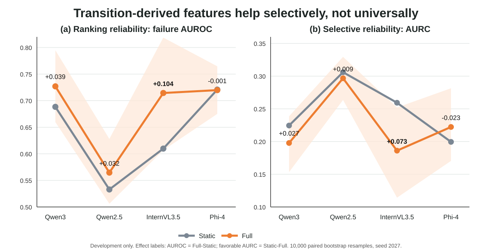
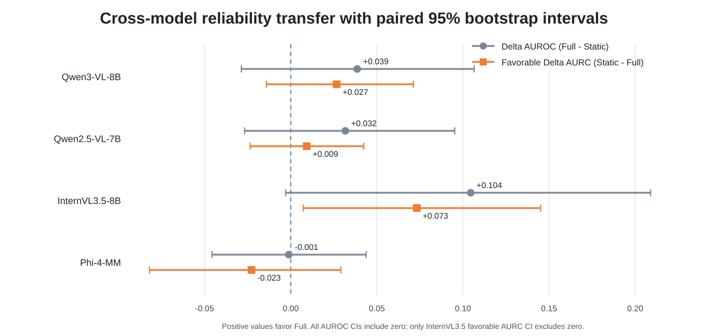
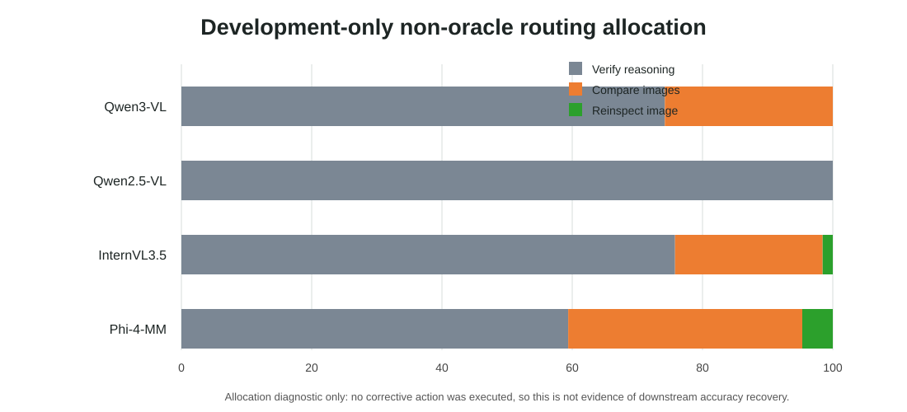

# U-MIRAGE

**Source-Aware Uncertainty Propagation for Reliable Multi-Image Vision-Language Reasoning**

[](https://github.com/Rocky5502/-U-MIRAGE/actions/workflows/ci.yml)


U-MIRAGE is a research codebase for diagnosing **where uncertainty originates** in multi-image vision-language reasoning and studying how uncertainty signals move from visual evidence, through cross-image integration, to downstream reasoning and answer-level risk.

The repository separates three source dimensions:

- **Visual uncertainty** — an individual image or local fact is unreliable.
- **Integration uncertainty** — individually interpretable evidence becomes unstable when combined across images.
- **Reasoning uncertainty** — the evidence is adequate but the final composition or decision is unreliable.

> **Research status (September 2026).** The machine-only development program is complete and auditable for RQ1--RQ4, including the matched-budget RQ3 action run and the exploratory hosted executor-transfer study. These are **development results**, not final protected-holdout claims. Calibration-60 and Holdout-360 remain sealed.

## Development result snapshot

All four local model families below were evaluated on the **same 128 development episode IDs** with model-specific direct predictions and structured local/joint probes. Static-vs-Full effects use **10,000 paired bootstrap resamples (seed 2027)**.

| Model | Static AUROC | Full AUROC | Delta AUROC [95% CI] | Static AURC | Full AURC | Favorable Delta AURC [95% CI] |
|---|---:|---:|---:|---:|---:|---:|
| Qwen3-VL-8B | 0.6884 | 0.7269 | +0.0386 [-0.0287, 0.1065] | 0.2245 | 0.1978 | +0.0267 [-0.0141, 0.0712] |
| Qwen2.5-VL-7B | 0.5329 | 0.5646 | +0.0317 [-0.0268, 0.0952] | 0.3060 | 0.2967 | +0.0093 [-0.0235, 0.0424] |
| InternVL3.5-8B | 0.6098 | 0.7144 | +0.1045 [-0.0029, 0.2089] | 0.2593 | 0.1861 | **+0.0732 [0.0072, 0.1451]** |
| Phi-4-MM | 0.7208 | 0.7198 | -0.0011 [-0.0457, 0.0438] | 0.1995 | 0.2223 | -0.0228 [-0.0820, 0.0291] |

**Interpretation.** Transition-derived features help selectively, not universally. Every AUROC interval includes zero; only the favorable InternVL3.5 AURC interval excludes zero. The Full-vs-Static development comparison is **not** relabeled as the protected propagation result: the protected RQ2 comparison requires the exact same source signals with and without the frozen propagation operator.

<p align="center">
  
</p>

<p align="center"><em>Development-only reliability profile across four local VLM families.</em></p>

<p align="center">
  
</p>

<p align="center"><em>Paired bootstrap effects. Positive values favor Full; the plot preserves mixed and negative outcomes.</em></p>

<p align="center">
  
</p>

<p align="center"><em>Routing allocation is a diagnostic only: corrective actions were not executed in this analysis.</em></p>

## Machine-only development completion snapshot

The final development-stage runs preserve negative and null outcomes rather than tuning after inspection:

| Study | Development finding | Claim boundary |
|---|---|---|
| RQ1 construction-intent stress test | Integration selectivity is approximately null; visual and reasoning selectivity are negative under the declared interventions. | Construction intent only; no human source-label validation claim. |
| RQ2 exact same-signal propagation | AUROC 0.6862 -> 0.6838; paired delta -0.0024, 95% CI [-0.0130, 0.0085]. AURC is likewise essentially null/slightly unfavorable. | P81 development evidence; not final holdout. |
| RQ3 matched-budget actions | Base accuracy 0.6484. Every one- and two-call repair policy produced post-action exact-match accuracy 0.0000 in this run; U-MIRAGE-vs-VERIFY/REQUERY paired differences are therefore 0.0000. | Treat as a strong execution/parsing failure signal, not evidence that all repair policies intrinsically destroy accuracy. P81 development only. |
| Hosted executor transfer | GPT-family endpoint: no source-conditioned advantage. Gemini-family endpoint: +0.1250 vs VERIFY and +0.0625 vs REQUERY, but both 95% CIs include zero. | Exploratory 32-episode development cohort; hosted uncertainty-estimator gate remains failed/closed. |

The RQ3 result is intentionally reported exactly as evaluated. Because all repair arms collapse to zero while the frozen base remains 0.6484, the repository treats this as a **diagnostic red flag requiring parser/output-contract investigation before any efficacy interpretation**. No post-hoc prompt, threshold, or policy redesign is used to turn it into a positive result.

More details and claim boundaries are in [`docs/RESULTS.md`](docs/RESULTS.md).

## Install

Clone into a normal local directory name even though the GitHub repository begins with a hyphen:

```bash
git clone https://github.com/Rocky5502/-U-MIRAGE.git U-MIRAGE
cd U-MIRAGE
python -m venv .venv
source .venv/bin/activate   # Windows PowerShell: .venv\Scripts\Activate.ps1
python -m pip install --upgrade pip
pip install -e '.[dev,data,analysis]'
pytest -q
```

For local VLM inference:

```bash
pip install -e '.[vlm]'
```

For official hosted-provider SDKs:

```bash
pip install -e '.[api]'
```

For a full research workstation environment:

```bash
pip install -e '.[dev,vlm,data,analysis,api]'
```

## Local model families

The development study uses the following official Hugging Face repositories. Exact immutable revisions belong in run provenance; do **not** silently replace the frozen revision with the current Hub head.

| Family | Official model repository |
|---|---|
| Qwen3-VL-8B-Instruct | https://huggingface.co/Qwen/Qwen3-VL-8B-Instruct |
| Qwen2.5-VL-7B-Instruct | https://huggingface.co/Qwen/Qwen2.5-VL-7B-Instruct |
| InternVL3.5-8B-Instruct | https://huggingface.co/OpenGVLab/InternVL3_5-8B-Instruct |
| Phi-4-multimodal-instruct | https://huggingface.co/microsoft/Phi-4-multimodal-instruct |

See [`configs/models.yaml`](configs/models.yaml) and [`docs/MODEL_ADAPTERS.md`](docs/MODEL_ADAPTERS.md).

## Datasets and benchmark links

The current development evidence is grounded primarily in **MIHBench**, with COCO/POPE-based factual auditing where applicable. The repository stores manifests and derived metadata rather than redistributing restricted third-party media.

| Resource | Role | Official/public link |
|---|---|---|
| MIHBench | Main multi-image hallucination benchmark | https://huggingface.co/datasets/MM-Hallu/MIHBench |
| MIHBench paper | Benchmark paper | https://arxiv.org/abs/2508.00726 |
| MIHBench/DAB code | Upstream code | https://github.com/pgtrece/DAB |
| MS COCO | Image/instance annotations | https://cocodataset.org/ |
| POPE | Object-presence auditing | https://github.com/RUCAIBox/POPE |
| POPE paper | EMNLP 2023 | https://aclanthology.org/2023.emnlp-main.20/ |

Additional generalization candidates and licensing notes are tracked in [`data/DATASETS.md`](data/DATASETS.md), including MIOH, VisChainBench, REST/REST+, HallusionBench, and MMMU.

## Hosted API providers

U-MIRAGE keeps provider credentials **outside Git**. The repository documents direct, first-party provider configuration rather than storing gateway aliases or private keys.

| Provider | Credential variable | Official documentation |
|---|---|---|
| OpenAI (GPT-family via OpenAI API) | `OPENAI_API_KEY` | https://developers.openai.com/api/ |
| Anthropic (Claude) | `ANTHROPIC_API_KEY` | https://docs.anthropic.com/ |
| Google (Gemini) | `GEMINI_API_KEY` | https://ai.google.dev/gemini-api/docs |
| Hugging Face Hub | `HF_TOKEN` | https://huggingface.co/docs/hub/security-tokens |

Use [`.env.example`](.env.example) only as a variable-name template. Never commit `.env`, API keys, access tokens, service-account JSON, or model-provider credentials. See [`docs/API_PROVIDERS.md`](docs/API_PROVIDERS.md) and [`SECURITY.md`](SECURITY.md).

## Quick local smoke test

```bash
python scripts/make_demo_data.py
python scripts/run_smoke.py
```

Smoke artifacts are plumbing tests and are **not paper results**.

For real local inference:

```bash
python scripts/run_jsonl.py \
  --input <normalized-development.jsonl> \
  --output artifacts/dev/qwen3vl8b \
  --adapter qwen \
  --model-id Qwen/Qwen3-VL-8B-Instruct \
  --revision <FROZEN_REVISION>
```

See [`docs/LOCAL_RUN.md`](docs/LOCAL_RUN.md) for the reproducibility checklist.

## Scientific contract

U-MIRAGE follows five repository-level rules:

1. **Development is not protected evaluation.** Development diagnostics are clearly labeled and never promoted into final holdout claims.
2. **Source semantics are task-grounded.** Intervention identity is not automatically treated as ground-truth uncertainty source.
3. **Same-signal comparisons matter.** A representation ablation is not a substitute for the protected propagation comparison.
4. **Negative outcomes stay visible.** Phi-4 non-transfer, rejected source proxies, and failed hosted-interface gates are retained.
5. **No secret or private credential belongs in the artifact.** CI runs a lightweight tracked-file secret scan in addition to normal tests.

## Repository map

```text
configs/                 model, provider, dataset, and experiment configuration
src/umirage/             reusable U-MIRAGE package
  adapters/              local/mock model boundaries
  signals/               visual/integration/reasoning uncertainty signals
  propagation.py         uncertainty propagation logic
  intervention.py        source-conditioned action policy
  evaluation.py          reliability/calibration metrics
scripts/                 runners, analysis utilities, and security checks
tests/                   deterministic unit/integration tests
data/                     dataset documentation/manifests; no restricted media
artifacts/                generated outputs (ignored except documentation)
docs/                     protocols, results, API setup, reproducibility, figures
```

## Reproducibility

Every paper-quality run should record:

- repository commit SHA;
- exact model identifier and immutable revision;
- dataset identifier/revision and manifest SHA256;
- prompt/template hash and parser version;
- generation parameters and random seeds;
- software/CUDA/GPU environment;
- model-call counts and run timing;
- split role (`development`, `calibration`, or `final_holdout`).

See [`docs/REPRODUCIBILITY.md`](docs/REPRODUCIBILITY.md).

## Anonymous-review note

The repository is currently suitable as a **private research repository**. Before making it public during an anonymous-review period, verify the venue's anonymity/artifact policy and remove any identity-bearing metadata that would violate it.

## License

Code is released under the MIT License. Dataset, model, and media licenses remain with their respective upstream owners.
