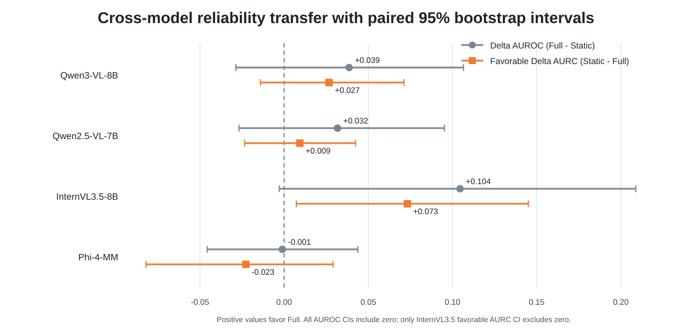

# Development results and claim boundaries

This page records the current **development-only** evidence synchronized with the U-MIRAGE manuscript package. It intentionally separates measured development findings from protected confirmatory claims.

## Four-model reliability transfer

Each local model is evaluated on the same 128 development episode IDs with its own direct predictions and structured local/joint probes. The paired comparison below uses 10,000 bootstrap resamples with seed 2027.

| Model | Static AUROC | Full AUROC | Delta AUROC [95% CI] | Static AURC | Full AURC | Favorable Delta AURC [95% CI] |
|---|---:|---:|---:|---:|---:|---:|
| Qwen3-VL-8B | 0.6884 | 0.7269 | +0.0386 [-0.0287, 0.1065] | 0.2245 | 0.1978 | +0.0267 [-0.0141, 0.0712] |
| Qwen2.5-VL-7B | 0.5329 | 0.5646 | +0.0317 [-0.0268, 0.0952] | 0.3060 | 0.2967 | +0.0093 [-0.0235, 0.0424] |
| InternVL3.5-8B | 0.6098 | 0.7144 | +0.1045 [-0.0029, 0.2089] | 0.2593 | 0.1861 | +0.0732 [0.0072, 0.1451] |
| Phi-4-MM | 0.7208 | 0.7198 | -0.0011 [-0.0457, 0.0438] | 0.1995 | 0.2223 | -0.0228 [-0.0820, 0.0291] |

Key interpretation:

- Three AUROC point estimates are positive, but **all AUROC confidence intervals include zero**.
- InternVL3.5 has the largest AUROC point shift (+0.1045).
- Only InternVL3.5 has a favorable AURC confidence interval fully above zero: +0.0732 [0.0072, 0.1451].
- Phi-4 moves in the unfavorable direction on both paired metrics.

## Same-input representation stress test

A separate development test holds direct/local/joint uncertainty fixed and changes only representation. All paired AUROC intervals cross zero:

| Model | Delta AUROC [95% CI] |
|---|---:|
| Qwen3 | +0.0096 [-0.0150, 0.0379] |
| Qwen2.5 | +0.0384 [-0.0030, 0.0793] |
| InternVL3.5 | -0.0016 [-0.0265, 0.0223] |
| Phi-4 | -0.0196 [-0.0695, 0.0308] |

This stress test is **not** the protected RQ2 propagation comparison.

## Source-grounding status

During development, intervention identity was rejected as source ground truth because intervention/prompt form could be separable without selectively increasing uncertainty at the intended processing stage. The source program therefore uses task-grounded earliest failure stages.

A balanced 200-episode grounded development pool was constructed (clean 51, visual 50, integration 45, reasoning 54), but origin auditing found that integration was substantially associated with one development origin. Consequently, a pooled four-class source classifier is prohibited: it could learn dataset origin rather than uncertainty source.

The current protocol uses origin-controlled, source-specific diagnosis instead of reporting a misleading pooled Macro-F1.

## Routing diagnostic

The current non-oracle router is retained as a diagnostic allocation study only:

- Qwen3: 95 VERIFY, 33 COMPARE.
- Qwen2.5: 128 VERIFY.
- InternVL3.5: 97 VERIFY, 29 COMPARE, 2 REINSPECT.
- Phi-4: 76 VERIFY, 46 COMPARE, 6 REINSPECT.

No corrective action was executed in this diagnostic, so it is **not evidence of recovered task accuracy**.

## Hosted access-regime audit

The hosted-model pilot tested whether one common observable uncertainty interface could be used fairly across compared endpoints. Text routing and multi-image capability passed, but common log probabilities were unavailable and all three predeclared common-observable fallbacks failed their shared usability gates. The full hosted-model efficacy sweep was therefore not launched and thresholds were not lowered post hoc.

## Completed machine-only development cycle

The machine-only amendment replaces the unfinished human-validation arm for the current development cycle. The resulting claim boundary is narrower: RQ1 is a construction-intent stress test, RQ2/RQ3 use machine-estimated source scores, and no human-validated source-ground-truth claim is made.

### RQ1 construction-intent selectivity

The completed 120-pair-per-source stress test gives:

| Intended source | Mean selectivity | 95% CI |
|---|---:|---:|
| Visual | -0.06537 | [-0.08944, -0.04296] |
| Integration | +0.00215 | [-0.03513, +0.03809] |
| Reasoning | -0.09188 | [-0.11767, -0.06811] |

The source-selectivity gate fails: visual and reasoning are negative, while integration is null.

### RQ2 exact same-signal propagation

On P81 development (n=128), the no-propagation control has AUROC 0.68621 and AURC 0.23836; the frozen propagator has AUROC 0.68380 and AURC 0.23972. The paired AUROC effect is -0.00241 [95% CI -0.01301, +0.00851], and the favorable AURC effect (control - propagation) is -0.00137 [95% CI -0.01502, +0.01050]. No primary propagation gain is established.

### RQ3 matched-budget execution

The full P81 machine-only run completed 1,920 rows (128 episodes x 5 policies x 3 budgets). Base/no-extra-call accuracy is 0.64844, but every nonzero-budget U-MIRAGE, VERIFY, REQUERY, and random-source cell scores 0.00000 under the frozen exact-match estimator.

Because all repair policies collapse identically, this is treated as a **degenerate output-validity result** rather than a substantive policy-efficacy conclusion. The raw rows retain final answers for post-hoc output-shape/parser diagnostics, but a relaxed parser must not replace the frozen primary estimator. No Source x Repair causal claim is made; random-source is auxiliary.

### Hosted executor transfer

A separate exploratory study used 32 fresh P81 development episodes and two hosted endpoints:

| Model | Base | Source-conditioned | VERIFY | REQUERY |
|---|---:|---:|---:|---:|
| gpt-6-astra | 0.8438 | 0.8438 | 0.8438 | 0.8438 |
| gemini-3.8-flash | 0.6250 | 0.6875 | 0.5625 | 0.6250 |

Paired source-conditioned effects:
- gpt-6-astra vs VERIFY: +0.0000 [-0.0938, +0.0938]; vs REQUERY: +0.0000 [0, 0].
- gemini-3.8-flash vs VERIFY: +0.1250 [-0.0625, +0.3125]; vs REQUERY: +0.0625 [-0.0938, +0.2500].

All intervals include zero. Gemini parseability also differs by condition, so the point estimates are exploratory executor evidence only.

See [MACHINE_ONLY_STATUS_2026-09-17.md](MACHINE_ONLY_STATUS_2026-09-17.md) for the full evidence boundary and hashes.

## Protected evaluation boundary

The following remain distinct from the development evidence above:

- protected RQ1 source selectivity;
- protected RQ2 exact same-signal propagation vs no-propagation control;
- protected RQ3 executed source-conditioned interventions vs matched-budget generic actions;
- calibration-only partition use after protocol freeze;
- one final sealed holdout execution.

Do not label development feature ablations as protected propagation improvement, and do not promote routing allocations into intervention-efficacy claims.
