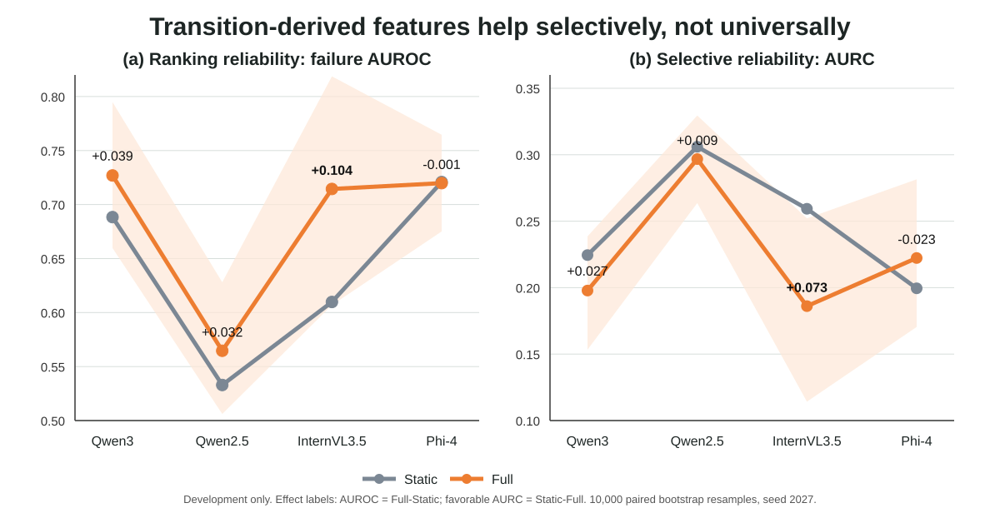
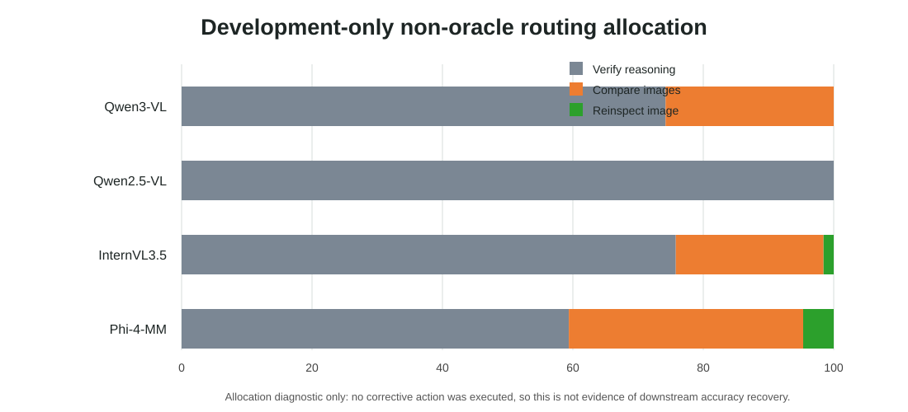

# Development results and claim boundaries

This page records the current **development-only** evidence synchronized with the U-MIRAGE manuscript package. It intentionally separates measured development findings from protected confirmatory claims.

## Four-model reliability transfer

Each local model is evaluated on the same 128 development episode IDs with its own direct predictions and structured local/joint probes. The paired comparison below uses 10,000 bootstrap resamples with seed 2027.

| Model | Static AUROC | Full AUROC | Delta AUROC [95% CI] | Static AURC | Full AURC | Favorable Delta AURC [95% CI] |
|---|---:|---:|---:|---:|---:|---:|
| Qwen3-VL-8B | 0.6884 | 0.7269 | +0.0386 [-0.0287, 0.1065] | 0.2245 | 0.1978 | +0.0267 [-0.0141, 0.0712] |
| Qwen2.5-VL-7B | 0.5329 | 0.5646 | +0.0317 [-0.0268, 0.0952] | 0.3060 | 0.2967 | +0.0093 [-0.0235, 0.0424] |
| InternVL3.5-8B | 0.6098 | 0.7144 | +0.1045 [-0.0029, 0.2089] | 0.2593 | 0.1861 | +0.0732 [0.0072, 0.1451] |
| Phi-4-MM | 0.7208 | 0.7198 | -0.0011 [-0.0457, 0.0438] | 0.1995 | 0.2223 | -0.0228 [-0.0820, 0.0291] |

Key interpretation:

- Three AUROC point estimates are positive, but **all AUROC confidence intervals include zero**.
- InternVL3.5 has the largest AUROC point shift (+0.1045).
- Only InternVL3.5 has a favorable AURC confidence interval fully above zero: +0.0732 [0.0072, 0.1451].
- Phi-4 moves in the unfavorable direction on both paired metrics.

## Same-input representation stress test

A separate development test holds direct/local/joint uncertainty fixed and changes only representation. All paired AUROC intervals cross zero:

| Model | Delta AUROC [95% CI] |
|---|---:|
| Qwen3 | +0.0096 [-0.0150, 0.0379] |
| Qwen2.5 | +0.0384 [-0.0030, 0.0793] |
| InternVL3.5 | -0.0016 [-0.0265, 0.0223] |
| Phi-4 | -0.0196 [-0.0695, 0.0308] |

This stress test is **not** the protected RQ2 propagation comparison.

## Source-grounding status

During development, intervention identity was rejected as source ground truth because intervention/prompt form could be separable without selectively increasing uncertainty at the intended processing stage. The source program therefore uses task-grounded earliest failure stages.

A balanced 200-episode grounded development pool was constructed (clean 51, visual 50, integration 45, reasoning 54), but origin auditing found that integration was substantially associated with one development origin. Consequently, a pooled four-class source classifier is prohibited: it could learn dataset origin rather than uncertainty source.

The current protocol uses origin-controlled, source-specific diagnosis instead of reporting a misleading pooled Macro-F1.

## Routing diagnostic

The current non-oracle router is retained as a diagnostic allocation study only:

- Qwen3: 95 VERIFY, 33 COMPARE.
- Qwen2.5: 128 VERIFY.
- InternVL3.5: 97 VERIFY, 29 COMPARE, 2 REINSPECT.
- Phi-4: 76 VERIFY, 46 COMPARE, 6 REINSPECT.

No corrective action was executed in this diagnostic, so it is **not evidence of recovered task accuracy**.

## Hosted access-regime audit

The hosted-model pilot tested whether one common observable uncertainty interface could be used fairly across compared endpoints. Text routing and multi-image capability passed, but common log probabilities were unavailable and all three predeclared common-observable fallbacks failed their shared usability gates. The full hosted-model efficacy sweep was therefore not launched and thresholds were not lowered post hoc.

## Machine-only RQ1 construction-intent stress test

The completed 120-pair-per-source construction-intent stress test does **not** support the intended positive source-selectivity pattern. Mean selectivity is -0.0654 for visual, +0.0021 for integration, and -0.0919 for reasoning; the visual and reasoning 95% bootstrap intervals are below zero, while integration spans zero. This is retained as a negative/null development result. It is not human-validated source ground truth.

## RQ2 exact same-signal propagation

On the 128-episode P81 natural-stage development bank, the frozen same-source-signal comparison gives:

| Metric | No propagation | Propagation | Paired effect |
|---|---:|---:|---:|
| AUROC | 0.6862 | 0.6838 | -0.0024 [-0.0130, 0.0085] |
| AURC | 0.2384 | 0.2397 | favorable control-minus-propagation -0.0014 [-0.0150, 0.0105] |
| AUPRC | 0.6240 | 0.6162 | descriptive |
| Brier | 0.2754 | 0.2732 | descriptive |
| ECE | 0.2563 | 0.2526 | descriptive |

The primary AUROC/AURC intervals cross zero. Small Brier/ECE changes are secondary and are not presented as a propagation win.

## RQ3 matched-budget action execution

The completed machine-only P81 run contains 1,920 rows: 128 episodes x 5 policies x 3 budgets. The raw grid passed validation before evaluation.

| Policy | Budget | Base acc. | Post acc. | Gain | Recovered errors |
|---|---:|---:|---:|---:|---:|
| U-MIRAGE | 0 | 0.6484 | 0.6484 | 0.0000 | 0/45 |
| U-MIRAGE | 1 | 0.6484 | 0.0000 | -0.6484 | 0/45 |
| U-MIRAGE | 2 | 0.6484 | 0.0000 | -0.6484 | 0/45 |
| VERIFY | 1 | 0.6484 | 0.0000 | -0.6484 | 0/45 |
| VERIFY | 2 | 0.6484 | 0.0000 | -0.6484 | 0/45 |
| REQUERY | 1 | 0.6484 | 0.0000 | -0.6484 | 0/45 |
| REQUERY | 2 | 0.6484 | 0.0000 | -0.6484 | 0/45 |

All four primary paired comparisons (U-MIRAGE vs VERIFY/REQUERY at budgets 1 and 2) are exactly 0.0000 with [0.0000, 0.0000] bootstrap intervals because every compared repair arm evaluates to zero exact-match accuracy.

This uniform collapse is **not interpreted as evidence that repair is intrinsically harmful**. It is a conspicuous execution/output-scoring diagnostic: the frozen base predictions remain at 0.6484 while every generated repair arm evaluates to zero. The result is preserved without post-hoc redesign, and efficacy claims are withheld pending an independent audit of generated-answer format and scoring compatibility. The Source x Repair causal matrix is not claimed; random-source is auxiliary.

Raw development evidence SHA256: `a37cd2215a1788183505e17195c0591a51fc27a6b0bd39535d3be3a51572c803`.

## Exploratory hosted executor transfer

A separate 32-episode fresh P81 development cohort tested source-conditioned repair execution on two hosted black-box model IDs after the common-observable uncertainty-estimator gate had already failed and remained closed.

| Hosted model ID | Base | Source-conditioned | VERIFY | REQUERY | Source - VERIFY [95% CI] | Source - REQUERY [95% CI] |
|---|---:|---:|---:|---:|---:|---:|
| `gpt-6-astra` | 0.8438 | 0.8438 | 0.8438 | 0.8438 | +0.0000 [-0.0938, +0.0938] | +0.0000 [0.0000, 0.0000] |
| `gemini-3.8-flash` | 0.6250 | 0.6875 | 0.5625 | 0.6250 | +0.1250 [-0.0625, +0.3125] | +0.0625 [-0.0938, +0.2500] |

Both Gemini paired intervals include zero. Parse coverage also differs across conditions, so the point estimates are not attributed solely to source-conditioned routing. This study is exploratory executor transfer, **not** hosted uncertainty-estimator transfer.

## Protected evaluation boundary

The following remain distinct from the development evidence above:

- the machine-only RQ1/RQ2/RQ3 development evidence reported above must not be promoted to final-holdout evidence;
- calibration-only partition use remains separate and sealed;
- one final sealed holdout execution remains separate;
- negative/null development outcomes remain frozen rather than triggering outcome-driven redesign.

Do not label development feature ablations as protected propagation improvement, and do not promote routing allocations into intervention-efficacy claims.
